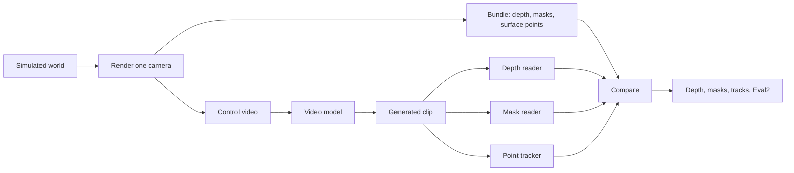
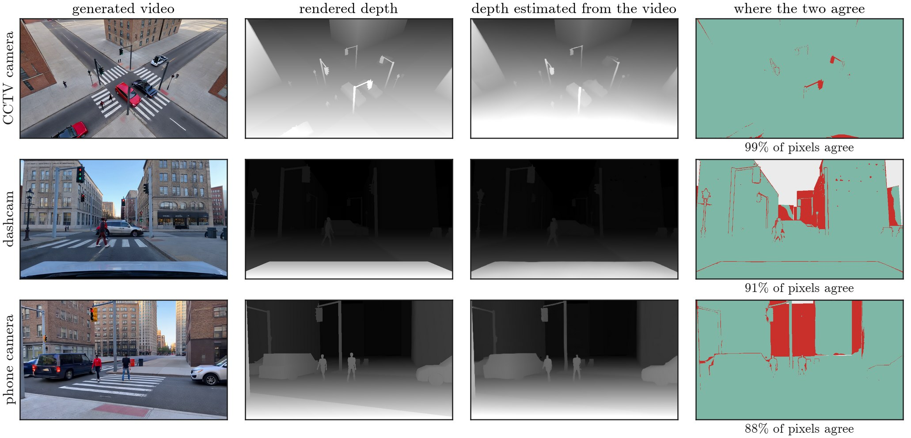
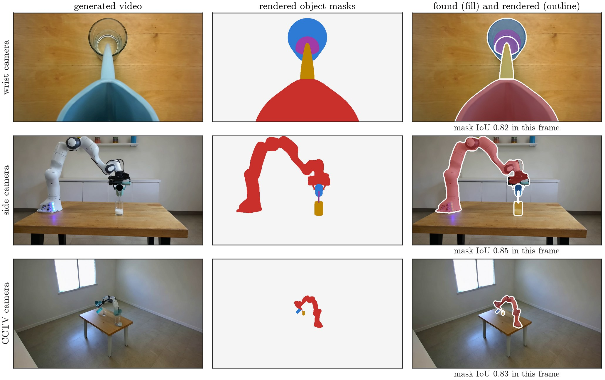
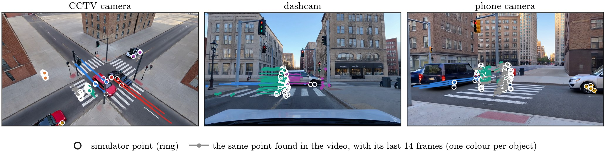
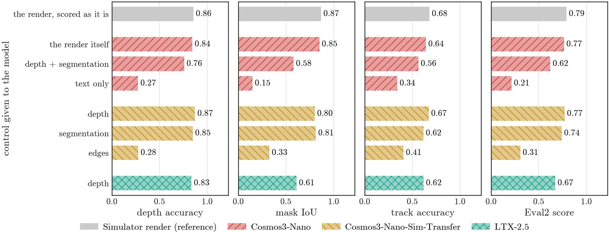

# Evaluation report: Eval1, Eval2, Eval3

Written 2026-11-24 with Claude Code. Status: **Eval2 is built and described here. Eval1 and Eval3 are left empty for now.**

The pipeline turns a prompt into a simulated world, renders that world from several cameras, and has a video model turn each camera's controls into a realistic clip. Three evaluations cover it:

| | Question | Status in this report |
| --- | --- | --- |
| **Eval1** | Prompt adherence: does the simulated world do what the prompt asked? | Empty |
| **Eval2** | Simulation adherence: does each generated clip follow the simulation? | Described below, with first results |
| **Eval3** | Cross-view consistency: do the cameras' clips show one world? | Empty |

Code: [`eval/run_eval.py`](../eval/run_eval.py). Reference for running it and for the output files: [`eval/README.md`](../eval/README.md).

## Eval1: prompt adherence

*Not written yet.*

## Eval2: simulation adherence

### 1. What it asks

A generated clip should keep the simulator's structure and motion and change only how things look. Eval2 asks three things of one camera's clip, each answered against something the simulator knows exactly:

| Score | Question | Simulator reference | Read from the video with |
| --- | --- | --- | --- |
| Depth | Is the scene's shape where the simulator put it? | Rendered depth | Depth Anything 3 (metric model) |
| Object masks | Is each object where the simulator put it, in every frame? | Rendered object masks | SAM 2.1 |
| Point tracks | Does each surface point move as in the simulation? | Surface points on every moving part, with visibility | CoTracker3 |

Each score is between 0 and 1, with 1 best. Eval2 is their harmonic mean.

Nothing in the scoring is specific to a scene. Every reference is read from the camera bundle that the render step writes, so a new scene needs no new evaluation code.



### 2. Notation

A clip has $T$ frames of size $W \times H$. A pixel is $p$, a frame is $t$, a simulated object is $o$, and a surface point is $i$. A hat marks a quantity read from the generated video; without a hat it is the simulator's.

### 3. Depth

Let $d_t(p)$ be the rendered depth and $\hat d_t(p)$ the depth estimated from the video. $\Omega_t$ is the set of pixels of frame $t$ where the render has a surface, so sky is left out.

A depth estimator returns depth up to an unknown scale. One scale per frame is removed with a ratio of medians:

$$
s_t = \frac{\operatorname{median}_{p \in \Omega_t} d_t(p)}{\operatorname{median}_{p \in \Omega_t} \hat d_t(p)},
\qquad
\tilde d_t(p) = s_t \, \hat d_t(p)
$$

A pixel passes when the two depths are within a factor of 1.25 of each other. The score is the share of pixels that pass, averaged over frames:

$$
S_{\text{depth}} = \frac{1}{T} \sum_{t=1}^{T} \frac{1}{|\Omega_t|} \sum_{p \in \Omega_t}
\mathbf{1}\left[ \max\left( \frac{\tilde d_t(p)}{d_t(p)}, \frac{d_t(p)}{\tilde d_t(p)} \right) < 1.25 \right]
$$



*Depth agrees over most of each view, and the failures are far building faces. Intersection scene, Cosmos3-Nano-Sim-Transfer with the depth control, seed 0, at 2.4 s. Each row is one camera. Left to right: the generated frame; the rendered depth; the depth estimated from the video, after scaling; and where the two agree within a factor of 1.25 (teal agrees, red does not, light grey is sky and is not counted). On a far surface a small error in estimated depth is a large ratio.*

The same count restricted to the pixels of simulated objects is also written (`depth_objects`). It is not part of Eval2.

### 4. Object masks

Let $M_{o,t}$ be the rendered mask of object $o$ in frame $t$, and $\hat M_{o,t}$ the mask found in the video. Their overlap is the intersection over union:

$$
\operatorname{IoU}(o,t) = \frac{|\hat M_{o,t} \cap M_{o,t}|}{|\hat M_{o,t} \cup M_{o,t}|}
$$

The score averages it over the set $P$ of object and frame pairs where the object is scored in that camera and its rendered mask has at least 100 pixels:

$$
S_{\text{mask}} = \frac{1}{|P|} \sum_{(o,t) \in P} \operatorname{IoU}(o,t)
$$

$\hat M$ comes from SAM 2.1. Each object is started once, from its simulator box and up to three clicks inside its mask, at the frame where the rendered mask is largest. SAM then follows it forward and backward through the clip.



*Each object sits where the simulator put it. Robot scene, Cosmos3-Nano-Sim-Transfer with the depth control, seed 0, at 3.5 s. Each row is one camera. Left to right: the generated frame; the rendered object masks, one colour per object; and the generated frame with each mask found in the video as a coloured fill under the rendered outline in white. Where fill and outline coincide, the overlap is high.*

### 5. Point tracks

The simulator carries a few points on the surface of every moving part. For point $i$ it knows the pixel position $x_i(t)$ in every frame and whether the point is visible. A tracker is handed each point at $q_i$, the first frame it is visible, and returns $\hat x_i(t)$ for the rest of the clip.

Errors are measured with the frame rescaled to $256 \times 256$, as in TAP-Vid, so thresholds mean the same at any resolution:

$$
e_i(t) = \left\lVert \left( \frac{256}{W}\,\Delta x_i(t),\ \frac{256}{H}\,\Delta y_i(t) \right) \right\rVert_2,
\qquad (\Delta x_i, \Delta y_i) = \hat x_i(t) - x_i(t)
$$

$C$ is the set of point and frame pairs after the hand-over frame where the simulator says the point is visible. The score is the share of those within a threshold, averaged over five thresholds:

$$
\delta_\tau = \frac{1}{|C|} \sum_{(i,t) \in C} \mathbf{1}\left[ e_i(t) < \tau \right],
\qquad
S_{\text{track}} = \frac{1}{5} \sum_{\tau \in \{1,2,4,8,16\}} \delta_\tau
$$



*Each simulator surface point is followed through the generated clip and compared with where the simulator puts it. Intersection scene, same clip, at 2.4 s. A white ring is where the simulator puts a surface point. The dot is where CoTracker3 finds that point in the generated video, with its last 14 frames as a trail; one colour per object. A dot away from its ring is drift from the simulation.*

How often the tracker's visible or hidden flag matches the simulator's is also written (`track_occlusion`). It is not part of Eval2.

Unlike motion between two consecutive frames, tracks accumulate error over seconds, so they catch slow drift. They take the place of the optical-flow score in the earlier proposal: the renderer does not write motion vectors yet, and with a fixed camera most pixels have no motion to measure.

### 6. The Eval2 score

$$
\text{Eval2} = \frac{3}{\dfrac{1}{S_{\text{depth}}} + \dfrac{1}{S_{\text{mask}}} + \dfrac{1}{S_{\text{track}}}}
$$

The harmonic mean is pulled toward the weakest of the three, so a clip cannot make up for failing one by doing well on another. It is zero if any score is zero.

- **Per clip:** the three scores of that clip.
- **Per scene, condition and seed:** each score is averaged over the camera views first, and the harmonic mean is taken after.

### 7. What is not counted

- An object in the camera that it carries. The dashcam car shows only its hood in its own camera.
- An object hidden from a camera, such as the bystander from the phone they hold.
- An object marked `eval: false` in the scene spec.
- In a cut video, nothing is followed across a cut: masks and tracks start again in each shot.

### 8. Reading a score: the render as reference

The three readers are models too. They are not perfect even on a clip that follows the simulator exactly. To know what a score means, the simulator's own textured render is scored with the same readers (`--on-render`). That is the most a generated clip can be expected to reach.

Per camera, seed 0. The generated clips are Cosmos3-Nano-Sim-Transfer with the depth control.

| Scene | Camera | Clip | Depth | Masks | Tracks | Eval2 |
| --- | --- | --- | --- | --- | --- | --- |
| intersection_4way | cctv | Render | 0.97 | 0.79 | 0.76 | 0.83 |
| | | Generated | 0.99 | 0.76 | 0.78 | 0.83 |
| | dashcam | Render | 0.75 | 0.87 | 0.54 | 0.69 |
| | | Generated | 0.79 | 0.73 | 0.47 | 0.63 |
| | phone | Render | 0.78 | 0.88 | 0.59 | 0.73 |
| | | Generated | 0.85 | 0.86 | 0.53 | 0.71 |
| robot_pour | wrist | Render | 0.67 | 0.92 | 0.59 | 0.70 |
| | | Generated | 0.66 | 0.84 | 0.71 | 0.73 |
| | side | Render | 0.99 | 0.91 | 0.75 | 0.87 |
| | | Generated | 0.99 | 0.90 | 0.74 | 0.86 |
| | cctv | Render | 0.97 | 0.84 | 0.85 | 0.88 |
| | | Generated | 1.00 | 0.78 | 0.85 | 0.86 |

Two things follow:

- **The ceiling depends on the camera.** Moving, low cameras (dashcam, wrist) are harder for the depth and track readers than high fixed ones, even on the render.
- **With depth control, the generated clips sit at the render's level.** The readers can barely tell them from a clip that follows the simulator exactly.

The clay render is not used as the reference. The depth and track readers do worse on plain grey surfaces than on textured ones.

### 9. Results so far: from the densest control to text only

The 89 earlier multi-camera clips and the 16 LTX-2.5 clips were scored. Each number is averaged over the three camera views, both scenes and the seeds available.



*With depth or segmentation as the only control, a clip follows the simulation about as closely as the simulator's own render does; with edges or text alone it does not. One panel per score, all from 0 to 1 with 1 best. Each row is one control given to one model, grouped by model, and within a model ordered from the control that carries the most to the one that carries the least. The grey row is the simulator's textured render scored with the same readers. Means over three cameras, two scenes and up to two seeds; no intervals are drawn because there are at most four runs per row. Data: [`scores_by_control.csv`](figures/2026-11-24-eval/scores_by_control.csv).*

| Control | Model | Scenes × seeds | Depth | Masks | Tracks | Eval2 |
| --- | --- | --- | --- | --- | --- | --- |
| Simulator render (reference) | | 2 | 0.86 | 0.87 | 0.68 | 0.79 |
| The render itself | Cosmos3-Nano | 4 | 0.84 | 0.85 | 0.64 | 0.77 |
| Depth + segmentation | Cosmos3-Nano | 4 | 0.76 | 0.58 | 0.56 | 0.62 |
| Depth | Sim-Transfer | 4 | 0.87 | 0.80 | 0.67 | 0.77 |
| Depth | LTX-2.5 | 4 | 0.83 | 0.61 | 0.62 | 0.67 |
| Segmentation | Sim-Transfer | 4 | 0.85 | 0.81 | 0.62 | 0.74 |
| Edges | Sim-Transfer | 2 | 0.28 | 0.33 | 0.41 | 0.31 |
| Text only | Cosmos3-Nano | 4 | 0.27 | 0.15 | 0.34 | 0.21 |

What it shows:

- **Depth or segmentation alone is enough to follow the simulation.** On Sim-Transfer both reach the render's level.
- **LTX-2.5 follows the depth less closely than Sim-Transfer does.** Its depth accuracy is close (0.83 against 0.87), but its mask IoU is lower (0.61 against 0.80). These are the only two models scored on the same control so far.
- **Text only is the floor.** Almost nothing is where the simulator puts it.

What limits a claim from this table:

- **Control and model are tangled.** The render, depth + segmentation and text-only clips are from Cosmos3-Nano. Depth, segmentation and edges are from Sim-Transfer. Depth + segmentation scoring below depth alone is most likely a difference between the two models. The four-model benchmark (`configs/experiments/cvp_v1/`) fixes the control at depth and varies the model; LTX-2.5 is its first model scored.
- **The LTX-2.5 and Sim-Transfer depth rows are not yet like for like.** The LTX clips are from the benchmark's own bundles; the Sim-Transfer clips are from the earlier run of the same scenes. The benchmark's Sim-Transfer run will replace that row.
- **The edges row is surprisingly low** and those clips have not been checked by eye.
- **Small sample.** Two scenes and at most two seeds per control.

### 10. Limits of the metrics

- **Depth is partly the control.** In a depth-controlled run the model is given the depth it is then scored on. Masks and tracks are the more independent signals.
- **The mask reader is told where each object is at one frame.** The score says whether one coherent thing stays where the simulator puts the object. It does not test that the thing is recognisable as a car or a person. A reader prompted by class name (SAM 3, as in the proposal) would add that; its weights are gated and were not available.
- **Tracks are low for small, distant or spinning parts, even on the render.** Compare with the render's score for that camera.
- **Scores are not comparable across cameras without the reference.** See section 8.
- **Older bundles.** Renders made before 2026-11-23 stored track points relative to each part's last pose. The loader corrects for it; the renderer is fixed, and that fix has not yet been confirmed with a fresh render.

### 11. Run it

```bash
source ~/.sim2real.env
PY=$S2R_ROOT/envs/eval/.venv/bin/python
EXP=configs/experiments/cvp_v1/cosmos3_sim_transfer.yaml

$PY eval/run_eval.py --exp $EXP                                              # the scores for every finished run
$PY eval/run_eval.py --exp configs/experiments/multicam_v1.yaml --on-render  # the render reference
$PY eval/summarize.py --exp $EXP --reference configs/experiments/multicam_v1.yaml --out table.csv
$PY eval/make_figures.py --exp $EXP --scene robot_pour --cond D --seed 0 --out docs/figures/<name> --table table.csv
```

Scores are written to `<scene>/r<rev>/scores/<experiment>/eval2.csv`, one row per clip.

The figures in this report follow the paper figure guide (`docs/docs/paper-figure-guide`, the repo `shourovj/paper-figure-guide`) and are drawn by [`eval/make_figures.py`](../eval/make_figures.py) with its `paperplot` library. Each has a PDF for the paper beside the preview shown here. The frame figures use the `multicam_v1.2` clips; the chart reads the CSV next to it.

## Eval3: cross-view consistency

*Not written yet.*
